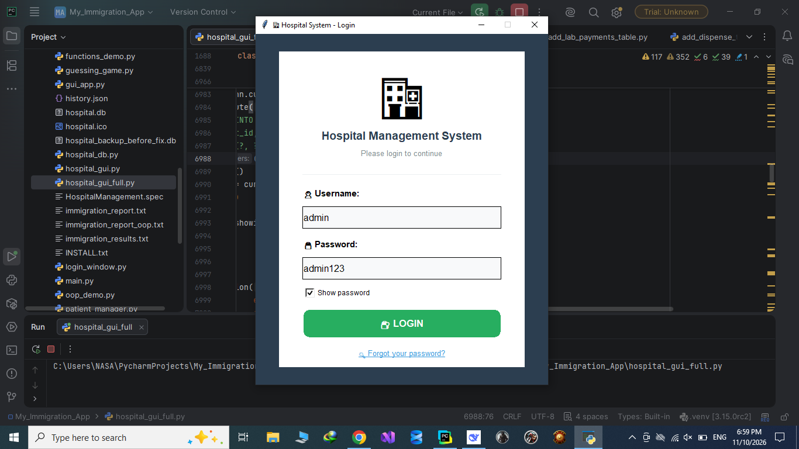
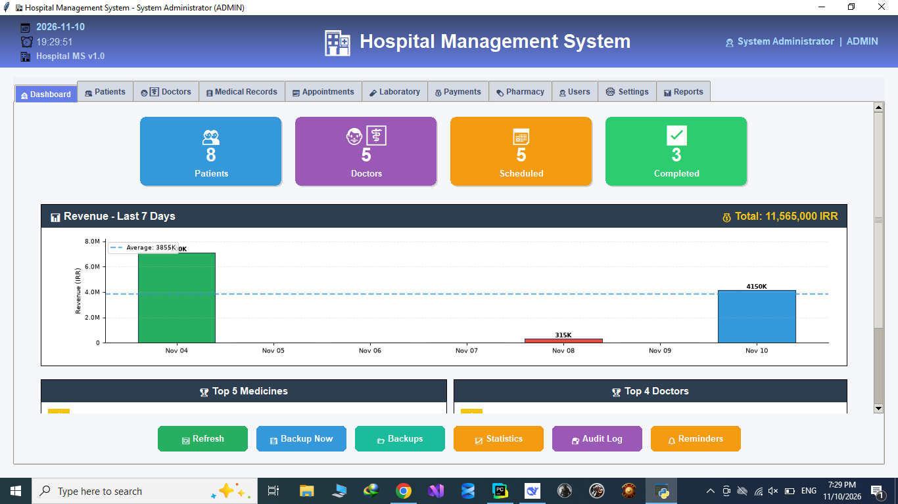
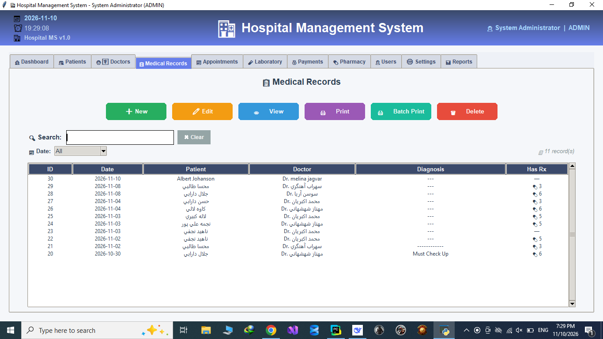
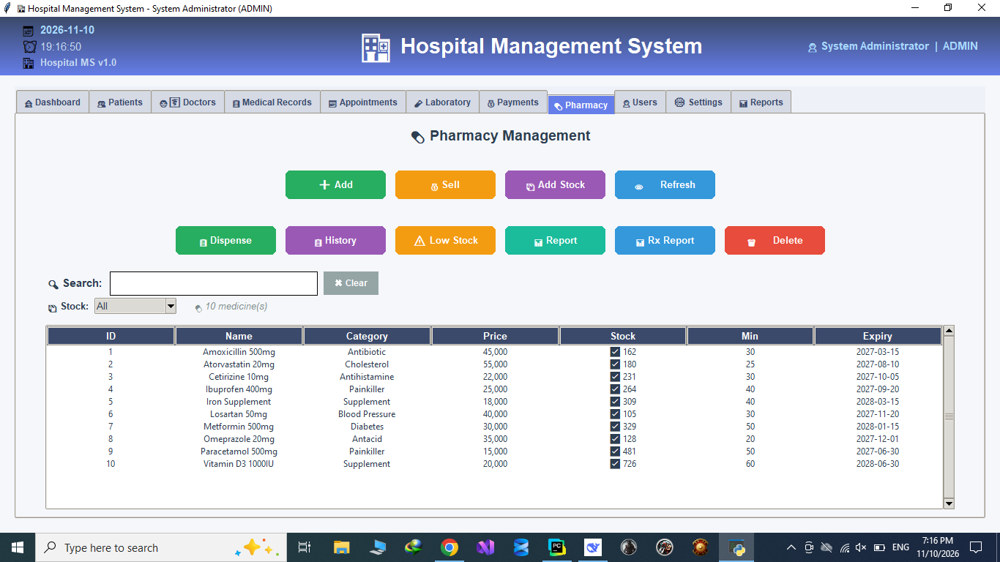

# 🏥 Hospital Management System (HMS)
# 🏥 سیستم جامع مدیریت بیمارستان

Email : spacex.nasa.starlink@gmail.com

<div align="center">
  
  <span style="background-color: #3776AB; color: white; padding: 6px 12px; border-radius: 6px; font-weight: bold; font-size: 14px; margin: 0 5px;">Python 3.10+</span>
  <span style="background-color: #2ECC71; color: white; padding: 6px 12px; border-radius: 6px; font-weight: bold; font-size: 14px; margin: 0 5px;"> , Tkinter UI </span>
  <span style="background-color: #003B57; color: white; padding: 6px 12px; border-radius: 6px; font-weight: bold; font-size: 14px; margin: 0 5px;"> , SQLite DB </span>
  <span style="background-color: #E67E22; color: white; padding: 6px 12px; border-radius: 6px; font-weight: bold; font-size: 14px; margin: 0 5px;"> , Status : Active</span>

</div>

## 🇬🇧 English Description

A comprehensive, fully-featured desktop application designed to manage all aspects of a clinic or hospital. Built with Python and Tkinter, it features a modern UI, complete patient lifecycle management, financial tracking, and inventory control.

### ✨ Key Features

*   **🔐 Role-Based Access Control:** Secure login system with roles (Admin, Doctor, Receptionist, Pharmacist).
*   **📊 Dynamic Dashboard:** Real-time statistics, 7-day revenue charts (Matplotlib), Top Doctors/Medicines, and appointment alerts.
*   **👥 Patient & Doctor Management:** Full CRUD operations, patient timelines, and medical histories.
*   **📅 Appointment System:** Scheduling, reminders for today/tomorrow, and conflict prevention.
*   **📋 Medical Records:** Electronic health records (EHR) with vital signs, diagnoses, and a smart prescription writer.
*   **🧪 Laboratory Module:** Request lab tests, input results, and link them directly to patient medical records.
*   **💊 Pharmacy & Inventory:** Stock management, direct sales, dispensing based on prescriptions, and low-stock alerts.
*   **💰 Billing & Payments:** Automated invoice generation for visits, pharmacy, and lab tests. Integrated PDF printing with Persian support.
*   **🖨️ Advanced Printing:** Custom printer routing (e.g., send prescriptions to a specific printer and invoices to another) with virtual PDF fallback.
*   **💾 Backup & Security:** Automated daily database backups, permanent archives, and a comprehensive system Audit Log.
*   **🎨 Modern UI:** Responsive design, rounded buttons, dark mode support, and highly customized Tkinter interface.

### 🛠️ Tech Stack
*   **Language:** Python 3
*   **GUI Framework:** Tkinter (Customized with Canvas)
*   **Database:** SQLite3
*   **Data Visualization:** Matplotlib
*   **PDF Generation:** FPDF2, Arabic Reshaper, Python-Bidi
*   **Excel Export:** OpenPyXL

### 🚀 Development Setup (Running from Source)

> ⚠️ **Note:** This project is currently in active development. The final executable (`.exe`) and packaging will be provided upon final release.

To run the source code for development or testing purposes:

1. **Clone the repository:**
   ```bash
   git clone https://github.com/YourUsername/Hospital-Management-System.git
   cd Hospital-Management-System
   
Create a virtual environment (Optional but recommended):

python -m venv venv
# Windows:
venv\Scripts\activate
# Mac/Linux:
source venv/bin/activate

Install dependencies:

pip install -r requirements.txt

Initialize the Database:
(Note: The hospital.db is ignored by Git. Run the setup script to create tables and the default admin user).

python setup_database.py

Run the application:

python hospital_gui_full.py

 Default Credentials (For Testing)
Username: admin

Password: admin123
(⚠️ Please change this immediately after first login in production).

🇮🇷 توضیحات فارسی
یک نرم‌افزار دسکتاپ جامع و کامل برای مدیریت تمام بخش‌های یک کلینیک یا بیمارستان. این پروژه با زبان پایتون و کتابخانه Tkinter ساخته شده و دارای رابط کاربری مدرن، مدیریت چرخه کامل بیمار، پیگیری مالی و کنترل موجودی انبار است.

✨ ویژگی‌های کلیدی
🔐 کنترل دسترسی بر اساس نقش: سیستم ورود امن با نقش‌های مختلف (مدیر سیستم، پزشک، پذیرش، داروساز).

📊 داشبورد پویا: آمار لحظه‌ای، نمودار درآمد ۷ روز اخیر (با Matplotlib)، برترین پزشکان و داروها، و هشدار نوبت‌های امروز و فردا.

👥 مدیریت بیماران و پزشکان: عملیات کامل ثبت، ویرایش و حذف، خط زمانی بیمار (Timeline) و تاریخچه پزشکی.

📅 سیستم نوبت‌دهی: زمان‌بندی، یادآوری نوبت‌ها و جلوگیری از تداخل زمانی.

📋 پرونده‌های پزشکی: ثبت علائم حیاتی، تشخیص، و یک سیستم هوشمند نسخه‌نویسی با کادرهای Spinbox برای سهولت کار پزشک.

🧪 ماژول آزمایشگاه: درخواست آزمایش از داخل پرونده، ثبت نتیجه و اتصال خودکار نتیجه به پرونده بیمار.

💊 داروخانه و انبار: مدیریت موجودی، فروش آزاد، تحویل دارو بر اساس نسخه، و هشدار اتمام موجودی.

💰 صورت‌حساب و پرداخت: صدور فاکتور خودکار برای ویزیت، داروخانه و آزمایشگاه. پشتیبانی از پرینت PDF با فونت فارسی.

🖨️ پرینت پیشرفته: تنظیم پرینتر اختصاصی برای هر سند (مثلاً نسخه‌ها به یک پرینتر و فاکتورها به پرینتر دیگر) با قابلیت ذخیره به عنوان PDF.

💾 بکاپ‌گیری و امنیت: بکاپ خودکار روزانه از دیتابیس، آرشیو دائمی، و سیستم ثبت لاگ (Audit Log) برای تمام فعالیت‌های سیستم.

🎨 رابط کاربری مدرن: طراحی واکنش‌گرا (Responsive)، دکمه‌های گرد، پشتیبانی از حالت تاریک (Dark Mode) و ظاهری کاملاً سفارشی‌سازی شده.

🛠️ تکنولوژی‌های استفاده شده
زبان برنامه‌نویسی: Python 3

رابط کاربری: Tkinter (سفارشی‌سازی شده با Canvas)

دیتابیس: SQLite3

نمودارها: Matplotlib

ساخت PDF: FPDF2, Arabic Reshaper, Python-Bidi

خروجی اکسل: OpenPyXL

🚀 راه‌اندازی محیط توسعه (اجرای کدها)
⚠️ نکته: این پروژه در حال حاضر در مرحله توسعه فعال قرار دارد. نسخه نهایی و فایل نصبی (.exe) پس از اتمام کار ارائه خواهد شد.

برای اجرای سورس‌کد جهت توسعه یا تست:

۱. دریافت پروژه (Clone):

git clone https://github.com/YourUsername/Hospital-Management-System.git
cd Hospital-Management-System

۲. ساخت محیط مجازی (پیشنهادی):

python -m venv venv
# ویندوز:
venv\Scripts\activate
# مک/لینوکس:
source venv/bin/activate

۳. نصب پیش‌نیازها:

pip install -r requirements.txt

۴. ساخت دیتابیس (بار اول):
(نکته: چون فایل hospital.db در گیت آپلود نمی‌شود، باید اسکریپت ساخت جداول را یک بار اجرا کنید.)

python setup_database.py

۵. اجرای برنامه:

python hospital_gui_full.py

🔑 اطلاعات ورود پیش‌فرض (برای تست)
نام کاربری (Username): admin

رمز عبور (Password): admin123
(⚠️ لطفاً پس از اولین ورود، رمز عبور را تغییر دهید).

📸 Screenshots / تصاویر







📄 License / مجوز
This project is licensed under the MIT License. / این پروژه تحت مجوز MIT منتشر شده است.

👨‍💻 Developer / توسعه‌دهنده

[Hossein Shahabi / حسین شهابی]

Email : spacex.nasa.starlink@gmail.com

GitHub: [@hshpp](https://github.com/hshpp/Hospital-Management-System.git)


